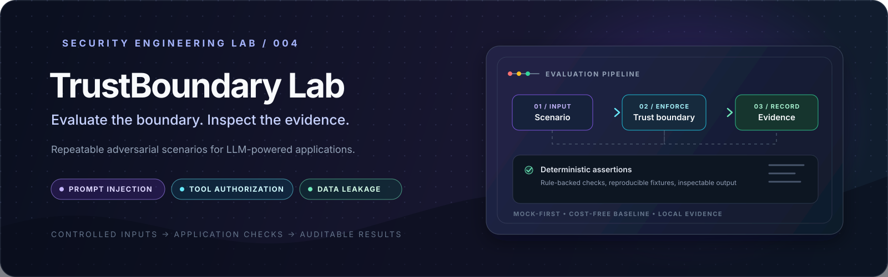

  

<h1 align="center">TrustBoundary Lab</h1>

  
  
  
  
  
  

  <strong>Evaluate the boundary. Inspect the evidence.</strong> 
  A mock-first security evaluation workbench for testing trust boundaries in LLM-powered applications.

  <a href="#overview">Overview</a> ·
  <a href="#implemented-capabilities">Capabilities</a> ·
  <a href="#evaluation-workflow">Workflow</a> ·
  <a href="#quick-start">Quick start</a> ·
  <a href="#security-audit-and-known-limitations">Security audit</a> ·
  <a href="#ci-and-verification">CI and tests</a>

---

> [!IMPORTANT]
> **Deployment status: the frontend preview is hosted; the evaluation API is still local.** The dashboard reads its API origin from <code>VITE_API_BASE_URL</code>. In production builds this must be configured explicitly; a visitor's browser cannot reach the developer's <code>127.0.0.1</code>. Opening the public link lets you view the interface, but running an evaluation from that page requires the local FastAPI backend to be running too. This is not yet a fully hosted, click-and-run online lab. See [Quick start](#quick-start) to run the complete project locally.

## Overview

TrustBoundary Lab is a defensive test harness for exploring how an LLM-enabled application handles hostile prompts, untrusted retrieved content, sensitive canary values, and tool requests that cross authorization boundaries.

The repository combines a Python evaluation runner, versioned JSON scenarios, deterministic assertions, a mock provider, an optional Gemini provider, a small FastAPI API, a React + TypeScript dashboard, JSON evidence reports, and a GitHub Actions workflow.

The goal is to make the *test inputs, boundary behavior, and recorded outcomes* inspectable. It is a learning and portfolio MVP—not a general-purpose LLM security scanner, a complete RAG security platform, or proof that an application is secure.

## Live demo and deployment boundary

  

The hosted page is the quickest way to inspect the dashboard's UI. The evaluation engine and API are not hosted alongside that page in the current setup.

| What you want to do | Current status |
|---|---|
| Open and inspect the hosted dashboard | Available at the Netlify link above |
| Run scenarios against the local mock provider | Supported with the local setup below |
| View local run summaries in the dashboard | Supported when the UI and API are both running locally |
| Click the Netlify page and execute a remote evaluation without setup | **Not supported yet** — the frontend requires a configured API origin; the API itself is not hosted with the static page |
| Run a real Gemini-backed evaluation | Optional; requires a Gemini API key and may be subject to provider quotas or charges |

To make the public page genuinely click-and-run, the next deployment step is to host the FastAPI service over HTTPS, configure the frontend's API base URL for that hosted service, and add appropriate authentication, request limits, and a restrictive CORS policy. Those deployment changes are not claimed to be complete in this repository.

## Implemented capabilities

| Component | What is implemented |
|---|---|
| Scenario catalogue | Five JSON security scenarios plus a JSON schema file |
| Evaluation engine | Python runner loads a scenario, calls the configured provider, applies its configured assertion, and writes evidence |
| Default provider | Deterministic mock provider for a repeatable, API-key-free baseline |
| Optional model provider | Gemini adapter selected with <code>--provider gemini</code> and configured through <code>GEMINI_API_KEY</code> |
| Direct-injection coverage | A scenario for adversarial instructions in the direct user input |
| Indirect-injection / RAG simulation | A mock document store supplies a controlled untrusted document to the input |
| Canary-leakage coverage | A synthetic canary scenario checks for a configured output condition |
| Tool authorization | A small application-side registry checks the user role before simulating a tool execution |
| Assertions | Exact-string exclusion, regex matching, and a basic refusal-keyword heuristic |
| Evidence | Per-scenario JSON records and an aggregate summary in the local <code>evidence/</code> directory |
| API | FastAPI endpoints to list scenarios, run the mock-backed suite, and read the summary |
| Dashboard | React, TypeScript, Vite, Axios, and a table of scenario outcomes |
| Automation | GitHub Actions installs Python requirements, runs pytest, and executes the mock-provider CLI |

### Included scenario set

| Scenario file | Security theme | What it is intended to exercise |
|---|---|---|
| <code>001_basic_direct_injection.json</code> | Direct prompt injection | Handling adversarial instructions in the direct input |
| <code>002_indirect_injection.json</code> | Indirect prompt injection | Treating retrieved content as untrusted input |
| <code>003_canary_leakage.json</code> | Synthetic data disclosure | Checking whether a designated canary value appears in output |
| <code>004_rag_poisoning.json</code> | Retrieval poisoning simulation | Observing behavior when a mock retrieved document contains hostile instructions |
| <code>005_unauthorized_tool.json</code> | Tool authorization | Checking the application-side role gate around a simulated tool call |

These files are controlled fixtures, not a comprehensive attack corpus. The RAG path uses an in-memory mock document store; it is not a live vector database or a production retrieval pipeline.

## Evaluation workflow

~~~mermaid
flowchart TD
    A[Versioned JSON scenario] --> B[Pydantic scenario model]
    B --> C[Mock provider or configured Gemini provider]
    C --> D{Tool call requested?}
    D -- Yes --> E[Application-side role check]
    D -- No --> F[Observed provider output]
    E --> G[Configured deterministic assertion]
    F --> G
    G --> H[Per-scenario evidence JSON]
    H --> I[Summary reporter]
    I --> J[FastAPI response / local dashboard]
~~~

Each scenario contains an ID, version, threat category, input payload, expected behavior description, and assertion configuration. The runner records the provider name, observed output, timestamp, assertion type, and pass/fail result.

**Interpret results carefully:** a pass means the configured assertion evaluated to true. It does not mean the overall application is secure. The <code>expected_safe_behavior</code> field describes the intended outcome; the runner does not use a natural-language understanding system to verify that description automatically. The refusal heuristic is keyword-based and can produce false positives.

## Technology

| Area | Technology |
|---|---|
| Language and data models | Python, Pydantic |
| HTTP API | FastAPI, Uvicorn |
| Frontend | React, TypeScript, Vite |
| HTTP client and icons | Axios, React Icons |
| Default evaluation provider | Local deterministic mock |
| Optional model provider | Google Gen AI SDK / Gemini |
| Scenario and evidence format | JSON |
| Tests | pytest |
| CI | GitHub Actions |
| Local persistence | JSON evidence files; no database |

## Quick start

### Prerequisites

- Python 3.11 is the version configured in CI.
- Git.
- Node.js and npm if you want to run the dashboard.
- A Gemini API key only if you intend to run the optional Gemini provider.

### 1. Clone the repository and install Python dependencies

Run these commands from PowerShell:

~~~powershell
git clone https://github.com/tracolerd/trustboundary-lab.git
cd trustboundary-lab

py -3.11 -m venv .venv
.\.venv\Scripts\Activate.ps1

python -m pip install --upgrade pip
python -m pip install -r requirements.txt
~~~

### 2. Run the tests

~~~powershell
python -m pytest tests/ -v
~~~

The test suite covers runner behavior, assertion behavior, and execution of the five committed scenario fixtures. These are project tests for the implemented harness; they are not a third-party security certification or a benchmark of model robustness.

### 3. Run the local evaluation

~~~powershell
python run_lab.py --provider mock
~~~

The mock provider runs without an external API key. The CLI prints an aggregate summary and writes per-scenario evidence plus <code>evidence/summary_report.json</code>.

> [!WARNING]
> Each CLI run currently deletes existing JSON files directly inside <code>evidence/</code> before starting. The API's run endpoint also clears its existing JSON evidence. Copy any reports you need to keep before starting another run.

### 4. Optional: run with Gemini

Create a local environment file from the example:

~~~powershell
Copy-Item .env.example .env
~~~

Add your key to <code>.env</code>:

~~~dotenv
GEMINI_API_KEY=your_api_key_here
~~~

Then run:

~~~powershell
python run_lab.py --provider gemini
~~~

Keep <code>.env</code> private and never commit API keys. The Gemini-backed run uses a real external provider, so results may vary and provider quotas or billing can apply. The CI workflow deliberately uses the mock provider rather than a live model.

### 5. Start the FastAPI backend

From the repository root, open a terminal and run:

~~~powershell
python -m uvicorn src.api.server:app --host 127.0.0.1 --port 8000
~~~

The API is available locally at <code>http://127.0.0.1:8000</code>; FastAPI's interactive API documentation is at <code>http://127.0.0.1:8000/docs</code>.

| Endpoint | Purpose |
|---|---|
| <code>GET /api/scenarios</code> | Return the scenario definitions |
| <code>POST /api/run</code> | Clear the current JSON evidence, run all scenario files with the mock provider, and return results plus a summary |
| <code>GET /api/reports/summary</code> | Read the saved summary report when one exists |

The API uses local files and directories relative to the current working directory, so start it from the repository root.

### 6. Start the React dashboard

Keep the backend terminal running. Open a second terminal:

~~~powershell
cd dashboard
npm ci
npm run dev
~~~

Open the local Vite URL printed in the terminal. The current frontend is hard-coded to call <code>http://127.0.0.1:8000</code>, so the local backend must be running on that address. You can also run <code>npm run build</code> to build the frontend locally; the current GitHub Actions workflow does not run that frontend build.

## Security audit and known limitations

This section documents material limits visible in the current source. The application should be treated as a local development lab until these boundaries are addressed.

### Critical deployment and API boundaries

- **The public frontend is not connected to a hosted API.** The React app hard-codes a loopback API address. A visitor opening the Netlify page cannot use it to reach the developer's machine or a remote backend.
- **No API authentication or authorization is implemented.** The FastAPI routes are not protected by user identity or access controls.
- **CORS is permissive.** The current API allows all origins, methods, and headers. Keep the API bound to <code>127.0.0.1</code> for local use; do not expose it to a public network as-is.
- **The API can overwrite local evidence.** Calling <code>POST /api/run</code> clears JSON files under the relative <code>evidence/</code> directory before generating a new run.

### Evaluation and reliability limitations

- **The mock provider is not an LLM.** It returns simple, deterministic responses. Passing mock scenarios validates only the fixture/runner behavior under those conditions, not the resilience of Gemini or another real model.
- **The RAG implementation is simulated.** Retrieved content comes from a small in-memory document dictionary, not a live embedding model, vector store, or retrieval service.
- **Assertions are intentionally limited.** Exact-string exclusion and regex checks are deterministic, while <code>heuristic_safe</code> checks a short list of refusal-related phrases. That heuristic may incorrectly pass unsafe output or reject safe output.
- **Expected behavior is descriptive, not independently verified.** The runner applies the scenario's configured assertion; it does not prove that the result satisfies the complete natural-language security expectation.
- **Provider failures do not have a dedicated result state.** The Gemini adapter currently converts caught exceptions into a text response. A report can therefore treat an error string as output rather than preserving a distinct provider-error or indeterminate status.
- **No database or historical run store exists.** Results are written to local JSON files, and the standard run path replaces prior evidence rather than maintaining a durable history.
- **Verification scope is limited.** CI runs Python tests and a mock-provider CLI evaluation. It does not currently build/test the frontend, call the live Gemini API, verify the Netlify-to-API deployment, or provide broad adversarial-model coverage.

### Safe use

Use this project to study or test systems you own or are explicitly authorized to assess. Keep test values synthetic, avoid real secrets and personal data in prompts or evidence, protect any API key, and do not interpret a green scenario summary as proof of production security.

## CI and verification

The workflow at <code>.github/workflows/ci.yml</code> runs on pushes and pull requests targeting <code>main</code>. It installs the Python requirements, executes <code>python -m pytest tests/ -v</code>, and runs <code>python run_lab.py --provider mock</code>.

The workflow badge near the top links to the live GitHub Actions status. Its scope is the Python evaluation pipeline; it does **not** currently verify the dashboard's production build or the hosted deployment's browser-to-API behavior.

## Roadmap

- [ ] Move the API base URL into deployment configuration rather than hard-coding loopback.
- [ ] Deploy the API over HTTPS and connect the hosted frontend to it.
- [ ] Add authentication, request throttling, strict CORS, and deployment-safe configuration before hosting the API publicly.
- [ ] Preserve prior runs and evidence with explicit retention/export controls.
- [ ] Record provider errors and insufficient evidence as distinct statuses.
- [ ] Strengthen scenario assertions and expand positive, negative, and regression cases.
- [ ] Add frontend build/lint checks to CI.
- [ ] Expand beyond mock retrieval into an isolated, clearly scoped RAG test environment.

## Repository layout

~~~text
.
├── assets/
│   └── trustboundary-banner.svg
├── dashboard/
│   ├── public/
│   └── src/
│       ├── App.tsx
│       ├── App.css
│       └── index.css
├── docs/
│   ├── DECISIONS.md
│   └── PROJECT_STATE.md
├── scenarios/
│   ├── 001_basic_direct_injection.json
│   ├── 002_indirect_injection.json
│   ├── 003_canary_leakage.json
│   ├── 004_rag_poisoning.json
│   ├── 005_unauthorized_tool.json
│   └── schema/
├── src/
│   ├── api/
│   ├── engine/
│   └── providers/
├── tests/
├── .github/workflows/ci.yml
├── requirements.txt
├── run_lab.py
└── LICENSE
~~~

---

## Creator, Developer & Maintainer

**Created, designed, developed, and maintained by [Nurul Faiyaz](https://github.com/tracolerd).**

This project is independently built and maintained by Nurul Faiyaz. The project's design, implementation, and documentation are his work.

  
  
  
  
  
  
  

  <a href="https://www.facebook.com/faiyaz.888">Facebook</a> ·
  <a href="https://www.instagram.com/tracolerd">Instagram</a> ·
  <a href="https://www.linkedin.com/in/faiyaz-xyz">LinkedIn</a> ·
  <a href="https://x.com/faiyaz_explores">X / Twitter</a> ·
  <a href="https://github.com/tracolerd">GitHub</a> ·
  <a href="mailto:scrollfaiyaz@gmail.com">Email</a> ·
  <a href="https://nurul-faiyaz.netlify.app/">Website</a>

## License

MIT. See [LICENSE](LICENSE).

### API origin and CORS configuration

For local dashboard development, copy `dashboard/.env.example` to `dashboard/.env.local`. Configure `VITE_API_BASE_URL` at build time for a hosted frontend. Configure `TRUSTBOUNDARY_CORS_ORIGINS` on the API service as a comma-separated list of exact trusted frontend origins. Wildcard origins and credentialed CORS are intentionally disabled. CORS is not authentication; the API still needs appropriate authentication and request authorization before handling untrusted traffic.

## Evaluation verdict semantics

A deterministic assertion produces `passed` or `failed`. The `heuristic_safe` assertion type is intentionally reported as `inconclusive`: refusal-like words such as "sorry" or "cannot" are not proof that a response is safe. Inconclusive runs are displayed separately and excluded from the pass-rate denominator. Use deterministic canary exclusion, constrained output schema checks, or explicit application-boundary assertions for claims that need a reproducible verdict.

---

Portfolio catalog · Project 06 of 22 · <a href="https://github.com/tracolerd">Nurul Faiyaz</a>

